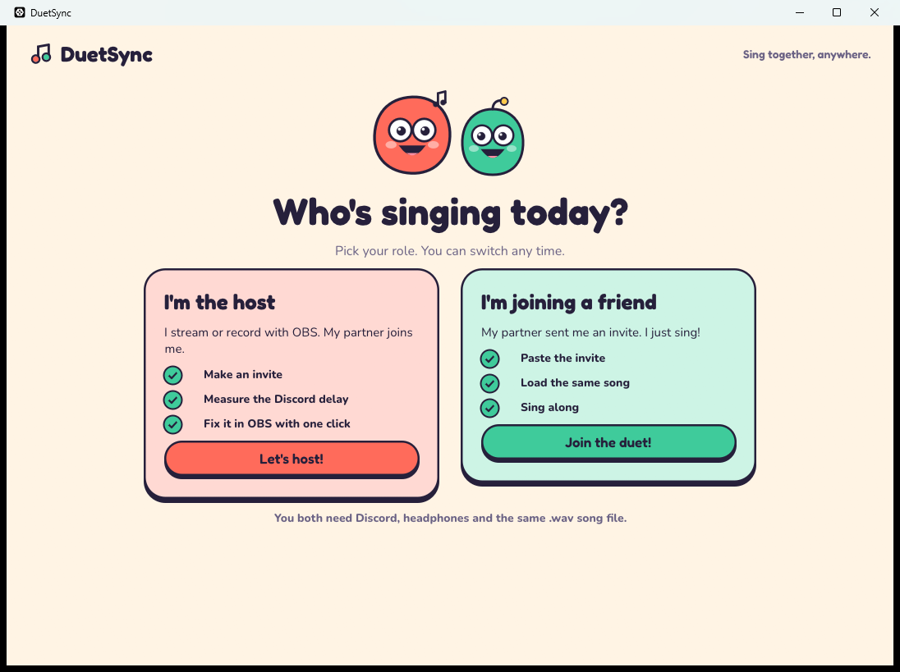
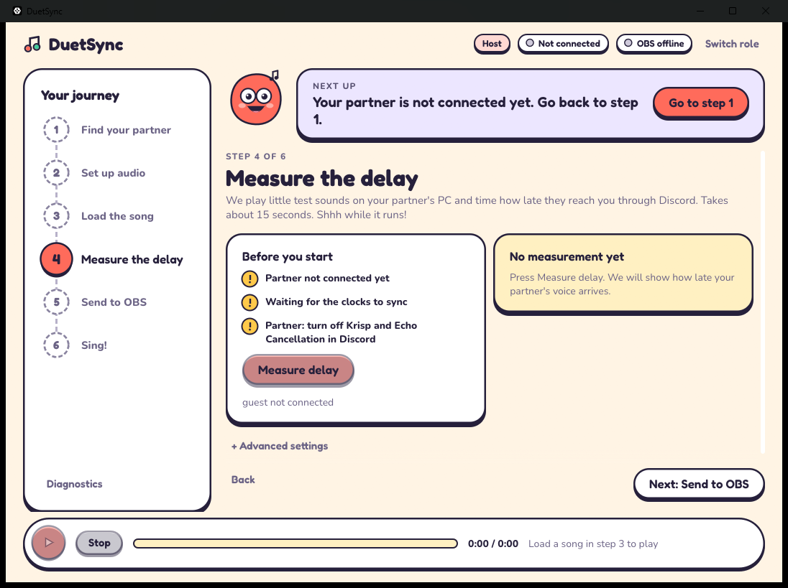

# DuetSync

**Sing together, anywhere.**





DuetSync is a small, free, open-source (MIT) Windows app for two performers who sing a
karaoke duet over Discord and want the **recording or livestream** to sound in time.

It does **not** remove internet latency. You will still hear your partner late in Discord,
as always. What DuetSync does:

1. Both of you hear the **same instrumental at the same moment**. Each PC plays its own
   local copy, and playback starts on a shared clock.
2. It **measures** how late your partner's voice reaches the host PC through Discord.
3. It **delays the host's own mic and instrumental in OBS** by that amount, so the audience
   hears both voices and the music lined up.

No account, no subscription, no cloud server, no AI, no browser engine, no Discord
modification, no audio driver to install.

---

## Requirements

- Windows 10 2004 or newer (Windows 11 recommended), 64-bit.
- Both performers: Discord (normal app), headphones, and the **identical** instrumental as a
  `.wav` file. Convert MP3s to WAV with any audio tool; both people must use the very same
  WAV file.
- Host only: OBS Studio 28+ (it includes obs-websocket 5).
- Internet on both PCs. Nothing else: no VPN, no router settings, no port forwarding.

### How joining works (and what it shares)

The invite works on the same Wi-Fi **and** from another house:
- **Same Wi-Fi:** DuetSync connects directly.
- **Different networks:** each PC asks Google's public STUN server for its public internet
  address. The two PCs swap these addresses through the free **ntfy.sh** relay, then open a
  direct connection through both routers ("hole punching").
- **What the helpers see:** the relay only ever stores **encrypted** data, and the music
  sync never goes through it. Both services can see your IP address, like any website you
  visit.
- **When it can't connect:** very strict networks (some mobile data and carrier-grade NAT)
  can't be punched through. DuetSync then says so; try a phone hotspot or another Wi-Fi
  on one side.

## Install

Download `DuetSync.exe` and run it. It is a single portable file.

- Settings are saved to `%APPDATA%\DuetSync\config.json`.
- **Portable mode:** put a `DuetSync.json` file next to the exe and settings are stored
  there instead. You can copy `DuetSync.example.json` to start.

Windows SmartScreen may warn about an unsigned app. Choose *More info → Run anyway* only if
you trust where you got the file (or build it yourself, see below).

---

## How the app guides you

On first launch DuetSync asks **"Who's singing today?"**. Pick **Let's host!** (you run OBS) or
**Join the duet!** (your partner invited you). You can change it later with **Switch role**.

After that, the left side shows **Your journey**: numbered steps. A star means a step is done,
and the big coloured circle is where you are. The mascot at the top always says what to do next
(**NEXT UP**). Each screen has one coloured button: coral for the host, mint for the guest. That
is the one to press. **Next** moves on; you can click any step to go back. Rarely needed options
are under **+ Advanced settings**.

### Before you start (host, once)

In OBS: *Tools → WebSocket Server Settings → Enable WebSocket server*, and set a password.
Create these audio sources (see [docs/OBS_ROUTING.md](docs/OBS_ROUTING.md)):
- your **microphone**;
- **Application Audio Capture** of **Discord** (your partner's voice);
- **Application Audio Capture** of **DuetSync** (your instrumental).

Mute or remove *Desktop Audio*, because it would add Discord and the music a second time.

### Host journey

1. **Find your partner:** press **Create session**, then **Copy invite**. Send it to your partner
   in a **private** Discord message. New joins stop when the code expires; a partner who
   already joined can always reconnect.
2. **Set up audio:** choose your headphones and microphone. "Your partner's voice" is
   normally **Discord app**. Press **Test partner's voice** while your partner talks.
3. **Load the song:** press **Choose song (.wav)** or drop the file on the window. Both of you
   need the exact same file (checked by fingerprint).
4. **Measure the delay:** press **Measure delay** and stay quiet for about 15 s (details below).
5. **Send to OBS:** connect OBS, tell DuetSync which source is which, press **Apply to OBS**.
6. **Sing!:** press **Play**. You both hear the music at the same moment.

### Guest journey

1. **Join your host:** paste the invite and press **Join**.
2. **Set up audio:** choose your headphones. "Where the test sound plays" must be something
   your **Discord microphone can hear**: speakers near the mic, or a virtual cable (e.g.
   VB-CABLE) set as Discord's input. Headphones do **not** reach the mic. Press **Test sound
   path**; it must say the sound was heard.
3. **Load the song:** the same .wav file as your host.
4. **Get ready to measure:** in **Discord → Voice & Video**, turn **off** Noise Suppression
   (Krisp) and Echo Cancellation, and let quiet sounds through. Your host starts the measurement.
5. **Sing!:** your host presses Play.

---

## Calibrate

Host: step 4 **Measure the delay** → **Measure delay**. Stay quiet for ~15 seconds.

- The guest's PC plays 8 short sweeps at moments fixed on the shared clock.
- They travel through the guest's mic → Discord → the host's PC.
- DuetSync finds each one by cross-correlation and reports the **median latency**, the
  **jitter**, an **uncertainty** range, and a **confidence**.
- Weak, missing, ambiguous or clipped sweeps are rejected. If fewer than 4 survive, the
  measurement is **rejected**: no number is invented.

Under **+ Advanced settings** you can instead type a **manual latency**, and use **Fine tune** (±ms) after listening to
a test recording.

Discord's delay changes over time and DuetSync cannot see it during a song. **Recalibrate
between songs.** The app warns when the measurement is old or when the network round trip
has changed.

## Apply to OBS

Host: step 5 **Send to OBS**:

```
target          = largest source latency + safety margin
offset (source) = your original offset + (target − source latency)
```

Example: guest latency 180 ms, margin 20 ms → your mic +200 ms, instrumental +200 ms,
Discord +20 ms.

Press **Apply to OBS**, review the table (original / now / new), and confirm.
DuetSync reads every value back from OBS and marks each one "verified" or "FAILED". Your original offsets are
remembered, so recalibrating **replaces** the compensation and never adds to it.
**Restore original** puts them back.

*Avatar video delay (manual, under + Advanced settings):* adds an OBS **Render Delay** filter (0–500 ms) to a host or
guest video source. Video latency is **not** measured. Set it by eye.

## Sing

Host presses **Play** (step 6 or the play bar at the bottom). Both PCs count down and start the instrumental at the same moment.
The host sees an **In time!** badge with how far the guest's player is from the host's.
Pause, Stop and seeking are mirrored to the guest. **Resync** restarts both players in
two seconds if something drifted.

Monitor yourselves with headphones the normal way (Discord + local music). **Never**
monitor through OBS's delayed output.

### YouTube songs

Instead of a .wav, the host can pick **YouTube link** in step 3, paste a link and press
**Use this video**. The guest gets the same video automatically (the match is the video id).

- **Open video** opens DuetSync's local player page (`http://127.0.0.1:...`) in your normal
  browser. The guest's page opens by itself. Keep that tab open: it plays the sound you hear.
- Browsers block sound until the page is clicked once. DuetSync shows **Click the video tab
  once to turn on sound** until you do.
- For your stream, add the **OBS Browser Source** URL shown in step 3: in OBS, Sources, +,
  Browser, paste the URL, size 1920x1080, tick **Control audio via OBS**. Pick that source as
  the Instrumental in step 5.
- DuetSync uses YouTube's official embedded player and never downloads anything. Both
  players are kept on the shared timeline to about +-50 ms (a small seek fixes bigger drift).
  The video's length is unknown, so only the elapsed time shows and seeking is off.
- Ads break sync until they end. YouTube Premium avoids ads.

### Auto-sync while singing

With **Auto-sync** on (the default), DuetSync measures the Discord delay from your actual
singing and keeps OBS up to date while a song plays.

- The guest's microphone and the host's capture of the guest's Discord voice are turned into
  a tiny loudness envelope and compared. About 1 KB per second goes from the guest to the
  host. Nothing is recorded or stored, and the captures stop when the song stops.
- The host sees **Live delay: 205 ms**. Estimates are smoothed. When the delay differs from
  the one in OBS by more than 30 ms in two checks in a row (and at least 10 s after the last
  update), OBS is updated by itself and the log says `Auto-sync: 182 -> 221 ms, OBS updated`.
  A tiny audio blip is possible with each update.
- It only changes OBS after DuetSync has applied offsets once (step 5) and OBS is connected.
  Otherwise it just shows the number. Recalibrating replaces the live value.
- Both of you need to sing. Silence, talking over the music or Krisp style noise suppression
  can hide the match; then nothing changes. The network ping is never used for this.

---

## Troubleshooting

See [docs/TROUBLESHOOTING.md](docs/TROUBLESHOOTING.md). Quick checks:

| Symptom | Fix |
| --- | --- |
| Guest can't connect | Both on the same DuetSync version? Whole invite pasted? Read the status line on the join screen: it says what's wrong. |
| "join code expired" | Host presses **New code** and sends the new invite. |
| Calibration rejected, 0 signals | Guest's Krisp/echo cancellation on, wrong calibration output, or test routing failed. |
| "Partner's file differs" | Not the same WAV (re-exported files differ). Send the exact file. |
| Echo in the recording | Desktop Audio or monitoring enabled in OBS. See routing guide. |

**Diagnostics** (bottom of the journey) → **Export diagnostics** writes a text report (passwords and join codes
redacted) next to the config file.

## Command line

```
DuetSync.exe --selftest              # audio hardware check (plays sweeps on default output)
DuetSync.exe --selftest --bench 30   # + idle CPU/RAM with an output stream open
DuetSync.exe --selftest --e2e        # host+guest on this PC through a VB-CABLE (silent)
DuetSync.exe --print-default-config  # example configuration
```

## Build from source

```
rustup default stable
cargo test
cargo build --release      # -> target\release\DuetSync.exe
```

## Documentation

- [OBS routing guide](docs/OBS_ROUTING.md)
- [Troubleshooting](docs/TROUBLESHOOTING.md)
- [Known limitations](docs/LIMITATIONS.md)
- [Test report](docs/TEST_REPORT.md) and the real two-computer checklist
- [Performance report](docs/PERFORMANCE.md)
- [Architecture](docs/ARCHITECTURE.md)

## License

MIT. See [LICENSE](LICENSE) and [THIRD_PARTY_NOTICES.md](THIRD_PARTY_NOTICES.md).
